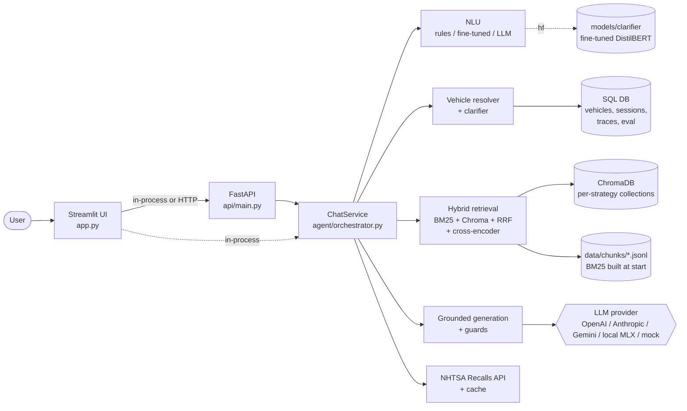
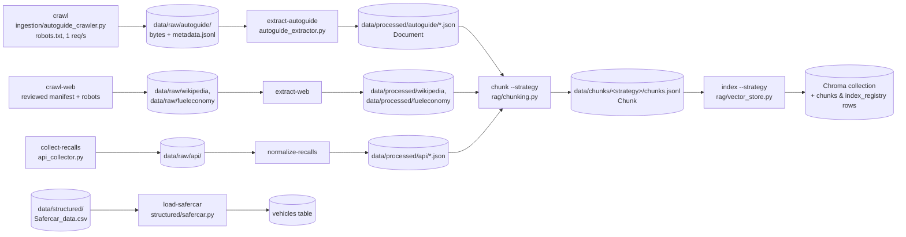
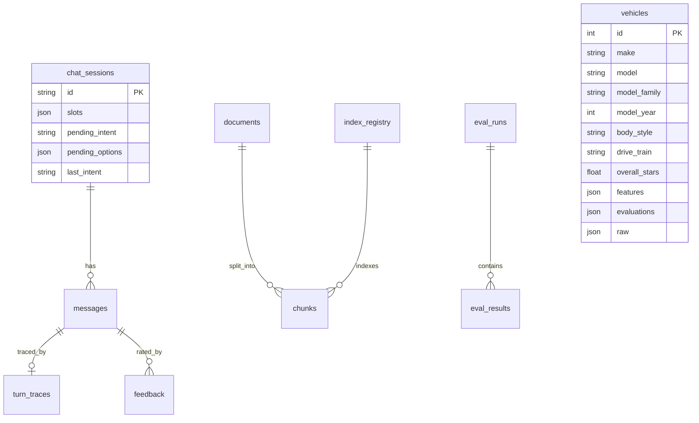
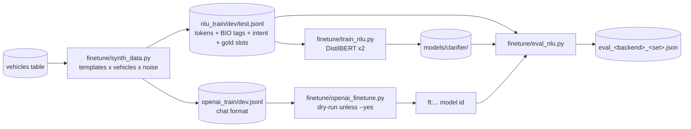

# AutoGuide AI: System Architecture

AutoGuide AI is a retrieval-augmented chatbot about vehicle information and safety. It answers from **AutoGuide.com safety articles**, **reviewed Wikipedia vehicle articles**, **FuelEconomy.gov pages**, **team-supplied reference PDFs**, and **NHTSA data** (the 5-Star ratings CSV and the Recalls API), and it cites every factual claim. It refuses when the evidence is not enough. When a question is about a specific vehicle and the vehicle isn't fully identified, it **asks a follow-up question** instead of guessing. ADR-010 records the owner-requested website expansion.

This document is the map for humans and coding agents. The contracts it describes live in code:

- `core/schemas.py` holds the data contracts.
- `core/config.py` holds every setting.
- `db/models.py` holds the storage schema.

If this document and the code disagree, the code wins. Fix the document in the same PR.

---

## 1. Scope

**In scope**
- Explaining how safety features work: answered with RAG over AutoGuide.com safety articles (ADR-008).
- A specific vehicle's 5-Star ratings and safety-feature availability: answered from the NHTSA ratings data in `Safercar_data.csv`.
- Recalls for a vehicle: answered with the NHTSA Recalls API, plus a reminder to check by VIN.
- Asking for missing vehicle details: year, make, model, or which variant.
- Vehicle history/overview via Wikipedia and efficiency/specifications via reviewed web documents. Numerical vehicle specifications require year-scoped metadata; yearless model articles cannot answer model-year specification questions.
- Team-supplied reference PDFs, including IIHS protocols (ADR-009); these are imported locally, not crawled.
- Refusing out-of-scope questions (prices, repair costs, insurance), unsupported predictions and prompt-injection attempts.

**Out of scope**
- Checking recall status for a specific VIN. The bot points users to nhtsa.gov/recalls instead.
- Repair advice or cost estimates.
- Crawling websites outside www.autoguide.com, en.wikipedia.org and www.fueleconomy.gov, including nhtsa.gov and iihs.org (ADR-010).

## 2. What already exists vs. what this architecture adds

| Area | Before | Now |
|---|---|---|
| Crawler, extractor, recalls API collector | `ingestion/*` (team) | unchanged; driven by `ingest.py` |
| Curated vehicle web sources | absent | `web_sources.py`, `web_extractor.py`: bounded robots-aware collection, offline extraction, attribution and strict retrieval scope (WP-11) |
| Hybrid retrieval (BM25 + Chroma + RRF) and reranker | `rag/retrieval.py`, `rag/reranker.py` (Chethan) | kept. Changes: pluggable embedder and collection, `retrieve_with_trace()`, per-strategy cache |
| Chatbot | `rag/chatbot.py` imported a missing `rag.evidence` | `rag/evidence.py`, `rag/generation.py`, `rag/prompts.py` added; `chatbot.py` is now a thin facade |
| UI | Soujanya's Streamlit dashboard (separate repo) | moved in as `app.py` + `assets/`; calls `api/client.py` |
| Chunking / embeddings / vector store | empty files | `rag/chunking.py` (fixed done, structure = WP-03), `rag/embeddings.py`, `rag/vector_store.py` |
| Vehicle data | none | `structured/` loads the ratings CSV into SQL; resolver; recalls tool |
| Agent | none | `agent/`: NLU, clarifier, guards, orchestrator |
| Fine-tuning | none | `finetune/`: synthetic data from the CSV, DistilBERT training, OpenAI option, NLU eval |
| API / DB / deployment | none | FastAPI (`api/`), SQLAlchemy (`db/`), Docker Compose |
| Evaluation | empty files | `evaluation/`: golden-set schema and split, metrics, B0–B3 runner |

## 3. System context



**Design rule: one core, thin adapters.** All behaviour lives in `ChatService.handle(ChatRequest) -> ChatResponse`. The UI, the HTTP API and the evaluation runner are thin callers of that one method, so a fix lands everywhere at once and evaluation measures exactly what users get.

WP-12 adds optional local MLX generation on Apple Silicon through the same `LLMClient` interface. It loads existing quantized weights lazily, serializes model access and reuses one model per path per process. With local generation, set `AUTOGUIDE_API_URL` so Streamlit shares the API's model instead of loading another copy. Readiness inspects artifacts/runtime availability without loading weights. Oversized prompts fail explicitly; evidence is never silently truncated. Model quantization is not fine-tuning on the corpus.

## 4. Offline pipeline (ingestion → index)

Every stage reads the previous stage's files and can be re-run on its own. For example, you can re-chunk without re-crawling, as proposal §5 requires.



| Command | Output | Contract |
|---|---|---|
| `python ingest.py crawl [--dry-run]` | AutoGuide.com pages: raw bytes, URL, timestamp and SHA-256 per page | `data/raw/autoguide/metadata.jsonl` |
| `python ingest.py extract-autoguide` | cleaned text with inline `## Heading` markers, tables, dates | `Document` (`source_type=autoguide_article`) |
| `python ingest.py crawl-web --dry-run` | offline reviewed manifest preview; no HTTP calls or contact needed | `PageSeed` |
| `python ingest.py crawl-web --source wikipedia\|fueleconomy\|all` | snapshots with hash, URL, scope, time and honest User-Agent | `data/raw/<source>/metadata.jsonl` |
| `python ingest.py extract-web` | text, headings, tables and attribution; latest snapshot only | `Document` (`wikipedia_article` / `fueleconomy_page`) |
| `python ingest.py chunk --strategy fixed\|structure` | chunk files and stats | `Chunk`; ID format `doc:version:strategy:NNN` |
| `python ingest.py index --strategy …` | a fresh Chroma collection, verified for 0 orphans and 0 missing | `IndexRegistry` row records the model, dimension (384), metric (cosine) and normalisation |
| `python ingest.py load-safercar` | 17,313 vehicle rows with normalised features | `VehicleRecord` |
| `python ingest.py status` | counts per stage, compared with the corpus minimums | — |

There is **one Chroma collection per (strategy, embedding model, version)**, for example `nhtsa_structure_all-minilm-l6-v2_v1`. This lets B2 (fixed) and B3 (structure) coexist. Re-chunking means building a new collection, verifying it, evaluating both on the same dev questions, then activating the new one.

## 5. Online request flow

```mermaid
sequenceDiagram
    participant U as User
    participant S as ChatService
    participant N as NLU
    participant R as Resolver+Clarifier
    participant E as EvidenceChecker
    participant G as Generator+Guards
    U->>S: message (+ session_id)
    S->>S: input guard (prompt injection)
    S->>N: parse -> intent, slots, features
    S->>S: merge with session (pending clarification, slot carry-over, follow-ups)
    alt smalltalk / out_of_scope
        S-->>U: canned reply / refusal
    else vehicle_lookup / recall_lookup
        S->>R: resolve(slots)
        alt missing / not found / variants differ
            R-->>U: needs_clarification + options (buttons)
        else resolved (or all variants agree)
            R->>G: vehicle record evidence / recall records
        end
    else vehicle_info
        S->>S: ask missing make/model/year; carry clarification across turns
        S->>E: filter approved source + exact vehicle metadata BEFORE top-k
        E->>G: scoped chunks or refuse if missing
    else concept_question
        S->>E: hybrid retrieve 20 -> rerank -> top 5 -> sufficient?
        alt insufficient
            E-->>U: refusal (no_evidence / low_relevance / prediction)
        else
            E->>G: chunk evidence
        end
    end
    G->>G: LLM over numbered evidence, quote <=25 words, citations must exist
    G-->>U: answered + citations + disclaimer + trace
```

**Turn statuses** (`TurnStatus`): `answered`, `needs_clarification`, `refused`, `error`. Every response carries a `Trace` with:

- intent and slots;
- the 20 candidates before rerank, with BM25, dense, RRF and rerank scores;
- the evidence sent to the LLM;
- the sufficiency decision;
- guard flags;
- LLM tokens and cost;
- per-stage timings.

The UI's evidence inspector renders this trace, and the evaluator reads the same trace.

Conversation state and history are loaded in a short read transaction, then detached while retrieval and generation run. The session, user/assistant messages and turn trace are persisted together only after an answer is ready. Slow model calls therefore do not hold SQLite's writer lock against other conversations. Recall caching uses its own tool transaction before generation.

## 6. Components

| Module | Responsibility | Work package |
|---|---|---|
| `ingestion/` | crawl, extract, clean, recalls API | WP-01, WP-02 |
| `rag/chunking.py` | fixed (done) and structure-aware chunking | WP-03 |
| `rag/embeddings.py`, `rag/vector_store.py` | embedders; build, verify and activate collections | WP-04 |
| `rag/retrieval.py`, `rag/reranker.py`, `rag/evidence.py` | BM25, dense, RRF, rerank, sufficiency | WP-05 |
| `rag/generation.py`, `rag/prompts.py`, `agent/guards.py` | grounded generation, citations, refusals, safeguards | WP-06 |
| `agent/nlu.py`, `agent/clarifier.py`, `finetune/` | intent and slot NLU, clarification policy, fine-tuning | WP-07 |
| `structured/` | ratings data, resolver, recalls tool | WP-08 |
| `evaluation/` | golden set, metrics, B0–B3 runs, statistics | WP-09 |
| `api/`, `app.py`, `db/`, Docker | HTTP API, UI integration, persistence, deployment | WP-10 |
| Curated web-source integration across ingestion, retrieval, NLU and UI | source provenance, scope, attribution and offline integration | WP-11 (explicit cross-package integration) |
| `core/local_llm.py`, provider configuration, readiness and UI | optional local MLX inference and unknown-feature grounding | WP-12 |

## 7. Data stores

| Store | Technology | Holds | Why |
|---|---|---|---|
| Files | `data/` | raw bytes, processed docs, chunks, fine-tune data, eval runs | checkpointed stages; re-chunk without re-crawl |
| Relational | SQLite (default) or Postgres (Compose) via SQLAlchemy | vehicles, document and chunk registry, index registry, sessions, messages, traces, feedback, recall cache, eval runs | structured lookups, conversation state, auditability |
| Vector | ChromaDB (embedded `PersistentClient`) | chunk embeddings and flat metadata | proposal requirement; metadata filtering; delete by `doc_id` |
| Lexical | `rank_bm25`, in memory, built from `chunks.jsonl` at start | BM25 index | the corpus is small (< 10k chunks), so a separate service isn't worth it |



**Why SQLite by default:** zero setup on every teammate's laptop. Postgres is one environment variable away (`DATABASE_URL`) and is what Compose runs. All column types are portable.

## 8. The clarification agent

### 8.1 The key design decision

Only the data knows what's missing. NHTSA rates **10 versions of the 2019 Ford F-150**, and 32% of the make/model/year combinations in the CSV have more than one variant. A language model can't know that reliably, so the work is split into three parts.

1. **Understanding** (ML, fine-tunable): what does the user want, and which vehicle did they mention? This is the intent plus slots (`MAKE`, `MODEL`, `YEAR`, `BODY`, `DRIVE`, `FEATURE`).
2. **Deciding** (deterministic, in `agent/clarifier.py`): the resolver checks the slots against the `vehicles` table. The bot asks only when:
   - a required slot is missing;
   - the vehicle doesn't exist in the data; or
   - several variants match **and the answer differs between them**.

   If every variant gives the same answer, it does not ask. Recall questions never ask for a variant, because recalls are keyed by make, model and year. After three clarifications in a row, it stops asking and answers for all candidate variants.
3. **Phrasing**: templated questions with clickable options (variant labels, years, models). An LLM may rephrase them later, but it never makes the decision.

The result is that the decision is testable, the over-asking rate is measurable, and fine-tuning goes where ML adds value: typos ("camery"), aliases ("chevy"), lowercase common-word models ("my focus"), and intent in context.

### 8.2 Conversation state

`chat_sessions` stores:

- **Carried-over slots.** "What about the 2020 one?" reuses the last vehicle.
- **Pending clarification:** the intent, the features, the original question, and an options map from button label to `vehicle_id` or slot values.
- **Last intent.** "Does it have blind spot detection?" after a vehicle answer becomes a vehicle lookup.

### 8.3 NLU backends (same interface, switch with `NLU_BACKEND`)

`vehicle_info` extends the intent contract for history, specifications and efficiency. This route uses web metadata rather than the safety-rating variant resolver: rating variants do not define EPA engine/transmission variants. Missing year or variant metadata never acts as a wildcard. Existing classifiers require retraining for the new label; deterministic topic rules provide compatibility until then. Synthetic generation includes the new intent, but no training run was performed for WP-11.

| Backend | What it is | Cost | When |
|---|---|---|---|
| `rules` | gazetteer from the CSV plus regex and fuzzy matching | free, < 1 ms | default; the baseline to beat |
| `hf` | fine-tuned `distilbert-base-uncased`: intent classifier and BIO slot tagger | free; trains in about 15 min on CPU or 2 min on Colab | recommended fine-tune |
| `llm` | prompted LLM returning JSON, or an **OpenAI fine-tune** id (`NLU_LLM_MODEL`) | API calls; fine-tuning costs money | comparison and alternative |

## 9. Fine-tuning pipeline



- **Why synthetic data.** The CSV contains vehicles, not conversations. Templates combine real makes, models and years with realistic noise: casing, typos, aliases, "'19" for 2019, and omitted slots. Labels are correct by construction.
- **Leakage control.** The data is split by (make, model family) and by template, so the test split contains models and phrasings that training never saw.
- **Honest reporting.** Synthetic test scores overstate real performance. Always also report `evaluation/data/nlu_realistic.jsonl`, the hand-written queries. It has 30 seeds; extend it to 100 or more real phrasings.
- **Metrics:**
  - intent accuracy and macro-F1;
  - slot accuracy per slot;
  - decision accuracy: does it ask exactly when it should?;
  - asked-slot accuracy;
  - over-ask and under-ask rates;
  - latency.
- **Current baseline (rules, measured):**
  - synthetic test: intent 98.8%, make 83.8%, model 93.3%, decision accuracy 95.9%;
  - realistic seeds (30 queries): intent 96.7%, make 93.3%, model 93.3%, decision accuracy 96.7%.

  The fine-tune has to beat these numbers on the realistic set to justify itself. Most rule errors are typos and lowercase or abbreviated models.
- **Pipeline verified.** `train_nlu.py` was run end to end with a tiny, randomly initialised model; the real DistilBERT weights weren't reachable from the build machine. That toy model scored 99.4% intent on synthetic dev but only 83.3% on the realistic set. This is the synthetic-to-real gap in practice, and it's why the realistic set decides adoption.

## 10. RAG details

- **Retrieval** (`rag/retrieval.py`): BM25 (keeps tokens like `f-150`) and dense (MiniLM, cosine, L2-normalised) at 50 each, fused with RRF (k = 60) into the top 20, then a cross-encoder picks the top 5.
- **Sufficiency** (`rag/evidence.py`). RRF scores are rank-based and say nothing about relevance, so the check uses:
  - the cross-encoder logit (`MIN_RERANK_SCORE`) when reranking;
  - otherwise the top dense cosine similarity (`MIN_DENSE_SCORE`);
  - otherwise any BM25 overlap.

  Prediction questions ("when will my airbag fail") are refused before retrieval. **Tune the thresholds on the dev split only.**
- **Generation** (`rag/generation.py`):
  - evidence is rendered as delimited, numbered blocks;
  - instruction-like lines are stripped from retrieved text;
  - every factual sentence must carry a `[n]`;
  - citations are validated against the evidence (if invalid, the bot refuses);
  - any run of more than 25 consecutive source words is trimmed.
- **Follow-ups**: `condense_question()` prefixes short pronoun follow-ups with the previous question. LLM query rewriting is WP-05.
- ⚠️ **Known risk:** `all-MiniLM-L6-v2` truncates input at **256 word-pieces**, but the proposal's fixed chunks are about 500 tokens. The tail of long chunks is never embedded. `ingest.py index` reports `chunks_over_embedding_limit`. You have two options: report it as a finding, or test `BAAI/bge-small-en-v1.5`, which has the same 384 dimensions and a 512-token limit. Treat that as a one-change ablation.

## 11. API

| Method | Path | Purpose |
|---|---|---|
| GET | `/health` | liveness |
| GET | `/ready` | vehicles loaded, active indexes, LLM provider, NLU backend: check before a demo |
| POST | `/v1/chat` | `ChatRequest` → `ChatResponse` (statuses, citations, clarification, trace) |
| GET | `/v1/sessions/{id}/messages` | conversation history |
| POST | `/v1/feedback` | thumbs up/down on a message |
| GET | `/v1/vehicles/resolve` | resolver directly (`make`, `model`, `year`, `body_style`, `drive_train`) |
| GET | `/v1/vehicles/{id}` | one ratings record |
| POST | `/v1/retrieve` | retrieval only (debugging and retrieval evaluation) |

The interactive docs are at `http://localhost:8000/docs`. The UI uses `api/client.answer_question()`. It runs in-process by default; set `AUTOGUIDE_API_URL` to switch it to HTTP.

## 12. Configuration

Every knob is in `core/config.py`; `.env.example` documents them. The important ones:

| Variable | Default | Notes |
|---|---|---|
| `LLM_PROVIDER` | `auto` | uses OpenAI if a key is set, else Anthropic, else **mock**. The mock lets everything run without a key. |
| `OPENAI_API_KEY` / `OPENAI_MODEL` | — / `gpt-4o-mini` | key goes in `.env` only |
| `NLU_BACKEND` | `rules` | `hf` after training; `llm` + `NLU_LLM_MODEL` for an OpenAI fine-tune |
| `EMBEDDING_BACKEND` / `RERANKER_BACKEND` | `sentence-transformers` / `cross-encoder` | `hashing` / `none` give fully offline tests |
| `CHUNK_STRATEGY` | `fixed` | switch to `structure` when WP-03 lands |
| `DATABASE_URL` | SQLite file | Postgres in Compose |

## 13. Safety controls (proposal §8), all running in code

| Risk | Control | Where | Evidence in trace |
|---|---|---|---|
| Prompt injection from the user | pattern screen, then refusal | `agent/guards.check_user_input` | `input_injection_blocked` |
| Prompt injection in documents | instruction lines stripped; evidence delimited and labelled as data | `guards.sanitize_evidence_text`, `rag/prompts.py` | `evidence_N_instructions_removed` |
| Hallucinated sources | citations must reference provided evidence, or the bot refuses | `guards.validate_citations` | `citation_validation_failed` |
| Copying sources | runs of more than 25 consecutive words are trimmed | `guards.trim_long_quotes` | `quote_trimmed_to_25_words` |
| Unsupported predictions | refused before retrieval | `rag/evidence.py` (`PREDICTION`) | `reason=unsupported_prediction` |
| Over-reliance / high stakes | disclaimer and pointers to a technician and VIN lookup | `guards.disclaimer_for` | `disclaimer` field |
| Outdated recalls | live API with 24 h cache; "as of" date in no-recall answers; VIN reminder | `structured/recalls.py` | `recalls` status |
| PII | crawler excludes directory and login paths; no user PII stored beyond chat text | `ingestion/crawler.py` | — |

The tests in `tests/test_guards.py` and `tests/test_orchestrator.py` show each safeguard working, which is what the ethics report needs.

## 14. Evaluation architecture

- **Golden set:** `evaluation/data/golden_set.jsonl`, validated by `evaluation/golden_set.py` against the required 15/6/4/4/8/3 mix. Quotes are 25 words or fewer, and unanswerable questions must record what was searched. The 60/40 dev/test split is stratified and assigned only once.
- **Relevance is labelled by source URL, not chunk ID.** Chunk IDs differ between fixed and structure chunking, so URL labels are what let one golden set compare B1, B2 and B3 fairly.
- **Baselines:** B0–B3 are just `ChatOptions` on the same `ChatService` (`evaluation/run_evaluation.py`).
- **Metrics:**
  - Recall@5 and Recall@20;
  - MRR and nDCG@10;
  - citation validity;
  - correct-refusal and over-refusal rates;
  - p50/p95 latency;
  - cost per query;
  - bootstrap 95% CI and exact McNemar test.
- **Correctness** is graded by people. An `--judge` LLM option exists, but it must be spot-checked by hand.
- **Test-split discipline:** `--split test` requires `--confirm-test` and writes a lock file. A second test run is refused.

## 15. Deployment

- **Laptop:** `make setup && make data && make chunk && make index && make ui`. The in-process backend needs no server.
- **Full stack:** `docker compose up --build` runs Postgres, the API on :8000 and the UI on :8501. The first time, also run `docker compose run --rm api python ingest.py all`.
- **Secrets:** `.env` only. It is git-ignored and the Compose `env_file` reads it. Never commit a key or paste one into issues or PRs.

## 16. Delivery plan and critical path

The proposal's timeline is Friday to Sunday, so the critical path matters more than completeness.

| Phase | Must work | Owner WPs |
|---|---|---|
| **P0: demo-safe** | AutoGuide.com corpus crawled and extracted (WP-01, ADR-008); fixed chunks indexed; RAG answers with citations and refusals in the UI; the ratings CSV loaded | 01, 02, 04, 05, 06, 08 |
| **P1: rubric** | structure-aware chunking (B3); 40-question golden set; B0–B3 on dev, then the single test run; reports 01–07 | 03, 09 |
| **P2: agent upgrade** | fine-tuned NLU (`hf`) beating `rules` on the realistic set; LLM rephrasing of clarifications | 07 |
| **P3: production polish** | Postgres via Compose; Alembic migrations; per-vehicle citation deep links | 10, 08 |

**Top risks**

1. **Source change.** The corpus moved from nhtsa.gov (which returned 403) to AutoGuide.com (ADR-008). The proposal still names NHTSA, so the PM must get instructor sign-off. Also confirm the crawl reaches 150 or more pages, 5 or more PDFs (AutoGuide has few PDFs, so ask whether this can be waived) and 3 or more pages with tables. See WP-01.
2. **Synthetic-only NLU evaluation** overstates quality. Grow the realistic set.
3. **MiniLM's 256-token limit** versus 500-token chunks (see §10).
4. **Threshold over-fitting.** Tune only on dev, and run test once.
